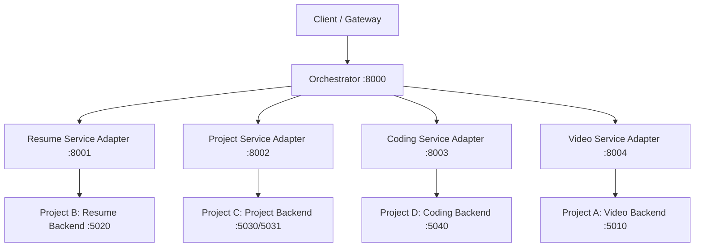

# Thozhil Microservices Architecture & Orchestration Specification

## 1. Overview & Architecture

The Thozhil platform introduces a decoupled microservices orchestration layer around four existing, independent AI recruitment applications:
1. **AI Resume Screener** (`services/resume-service`)
2. **AI Project Analyser / LogLense** (`services/project-service`)
3. **AI Coding Interviewer / Assessment Platform** (`services/coding-service`)
4. **AI Video Interviewer** (`services/video-service`)

Each application's underlying AI models, business logic, scoring mechanisms, and databases remain untouched. An **Adapter** wraps each application to expose a standardized REST interface, while a central **FastAPI Orchestrator** manages candidate state, workflow sequencing, score gating, retries, and aggregated reporting.



---

## 2. Service Boundaries & Port Allocations

| Component | Container Port | Host Port | Role | Underlying Project |
| :--- | :--- | :--- | :--- | :--- |
| **Orchestrator** | 8000 | 8000 | Candidate State Machine & Pipeline Gating | Central FastAPI Engine |
| **Resume Service Adapter** | 8001 | 8001 | Resume Screening Microservice Interface | Project B (FastAPI :5020) |
| **Project Service Adapter** | 8002 | 8002 | Code & Log Review Microservice Interface | Project C (Express :5030 / AI :5031) |
| **Coding Service Adapter** | 8003 | 8003 | Coding Exam & Submission Evaluator | Project D (Express :5040) |
| **Video Service Adapter** | 8004 | 8004 | Video Interview & Proctoring Evaluator | Project A (Express :5010) |

---

## 3. Internal Service URLs & DNS

When deployed in Docker Compose, services communicate over the bridge network `thozhil-network` via service DNS:
- `RESUME_SERVICE_URL=http://resume-service:8001`
- `PROJECT_SERVICE_URL=http://project-service:8002`
- `CODING_SERVICE_URL=http://coding-service:8003`
- `VIDEO_SERVICE_URL=http://video-service:8004`

For local development without Docker, set environmental variables to `http://localhost:8001`, `http://localhost:8002`, etc.

---

## 4. API Contracts

### Standardized Service Response Format
Where supported, adapters normalize responses to:
```json
{
  "candidate_id": "INT-901",
  "status": "COMPLETED",
  "score": 87.5,
  "evaluation": {
    "details": "Preserved original application response fields"
  },
  "metadata": {},
  "errors": []
}
```

Failure Response:
```json
{
  "candidate_id": "INT-901",
  "status": "FAILED",
  "score": null,
  "evaluation": null,
  "metadata": {},
  "errors": [
    {
      "code": "SERVICE_ERROR",
      "message": "Detailed exception description"
    }
  ]
}
```

### Orchestrator Core Endpoints
- `GET /health` -> Health status of Orchestrator and child microservice URLs.
- `POST /candidates` -> Registers or updates candidate metadata.
- `GET /candidates/{candidate_id}` -> Fetches candidate record and current state.
- `GET /candidates/{candidate_id}/state` -> Returns current `PipelineState`.
- `POST /candidates/{candidate_id}/pipeline/start` -> Runs pipeline across stages.
- `POST /candidates/{candidate_id}/pipeline/resume` -> Resumes or retries candidate pipeline.
- `GET /candidates/{candidate_id}/report` -> Returns aggregated `FinalEvaluationReport`.

---

## 5. State Machine & Workflow Gating

### State Machine Lifecycle
`CREATED` -> `RESUME_SUBMITTED` -> (`RESUME_PASSED` / `RESUME_REJECTED`) -> (`PROJECT_ANALYZED` / `PROJECT_REJECTED` / `PROJECT_PASSED`) -> (`CODING_COMPLETED` / `CODING_REJECTED` / `CODING_PASSED`) -> (`VIDEO_COMPLETED` / `VIDEO_REJECTED` / `VIDEO_PASSED`) -> `EVALUATION_REPORT` / `FAILED`.

### Configurable Score Gating
- `RESUME_MIN_SCORE` (Default: `60.0`)
- `PROJECT_MIN_SCORE` (Default: `60.0`)
- `CODING_MIN_SCORE` (Default: `60.0`)
- `VIDEO_MIN_SCORE` (Default: `60.0`)

If a stage returns a score below its configured threshold, the pipeline halts immediately and transitions to `<STAGE>_REJECTED`.

---

## 6. Resilience & Retry Strategy

- **Client**: `httpx.AsyncClient` with explicit timeouts (`connect=5.0s`, `read=15.0s`).
- **Retries**: 3 retry attempts with exponential backoff (`0.5s`, `1.0s`, `2.0s`).
- **Failure Isolation**: Service timeouts or HTTP 5xx errors isolate the candidate stage as `FAILED` without crashing the orchestrator process or state store.

---

## 7. State Storage & Database Schema

The orchestrator utilizes SQLite (`CandidateStateRepository`):
- `candidates`: Stores candidate identity, current `state`, timestamps.
- `stage_results`: Historical log of stage evaluations, scores, JSON raw evaluations, and error lists.

---

## 8. Development & Deployment

### Running Locally without Docker
1. Start original application servers (`:5010`, `:5020`, `:5030`, `:5040`).
2. Run microservice adapters:
   ```bash
   uvicorn services.resume_service.adapter.main:app --port 8001
   uvicorn services.project_service.adapter.main:app --port 8002
   uvicorn services.coding_service.adapter.main:app --port 8003
   uvicorn services.video_service.adapter.main:app --port 8004
   ```
3. Run orchestrator:
   ```bash
   uvicorn orchestrator.app.main:app --port 8000
   ```

### Running with Docker Compose
```bash
docker compose config
docker compose build
docker compose up -d
```

### Migration Path from Gateway Architecture
The new orchestrator operates alongside the existing Thozhil gateway (`:8080`) and Admin Shell (`:3000`). Admin Shell pages can query `/candidates/{id}/report` to render single-pane candidate evaluation summaries while preserving direct iframe mounting of single applications.
