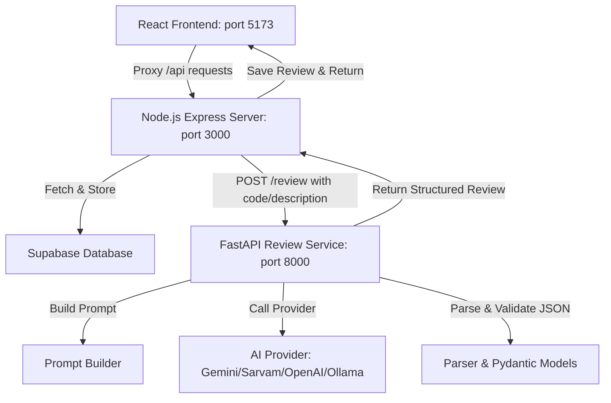

# AI-Powered Intern Review System (LogLense) – Status Report

This report provides a detailed overview of the system architecture, the current implementation status, verification results, and identified integration issues.

---

## 1. System Architecture & Workflow

The system is designed as an AI-powered add-on to an existing internship/project log management system. It automatically performs the first level of review on code submissions, generating detailed feedback for the intern and a high-level progress summary for managers.

- **Frontend (React + Vite, Port 5173)**: Displays the main dashboards (Intern and Authority) and proxies all `/api` traffic to the Node.js backend.
- **Node.js Express Server (Port 3000)**: Serves as the database integration layer using Supabase. When logs are submitted, it retrieves the corresponding work description, makes an API call to the FastAPI AI service, processes the response, and stores the serialized review in Supabase.
- **FastAPI Review Service (Python, Port 8000)**: Operates as an independent microservice (Module 3) that builds LLM prompts, queries AI providers, validates responses against Pydantic models, handles Text-to-Speech (TTS) optimization, and returns structured data.

---

## 2. Current Implementation Status

All core modules for the standalone AI Reviewer Engine (Module 3) are fully implemented and currently staged in Git. The Node.js server integration files are modified locally but unstaged.

### A. Staged Files (FastAPI Review Service)
- [app.py](file:///c:/Users/USER/intern/app.py): Bootstraps the FastAPI application, registers routes, sets up global error handling, configures rate limiting via SlowAPI, and restricts request payload sizes to prevent memory exhaustion.
- [routes.py](file:///c:/Users/USER/intern/routes.py): Exposes the `POST /review` endpoint to process review requests from the Node.js backend.
- [prompt_builder.py](file:///c:/Users/USER/intern/prompt_builder.py): Constructs prompt templates that guide the LLM to output clean JSON matching our requirements.
- [ai_provider.py](file:///c:/Users/USER/intern/ai_provider.py): Implements provider abstractions (Gemini, Sarvam AI, OpenAI, and Ollama) with a fallback logic system.
- [parser.py](file:///c:/Users/USER/intern/parser.py): Sanitizes raw LLM output, extracts JSON blocks, and parses them into schema models.
- [models.py](file:///c:/Users/USER/intern/models.py): Defines validation schemas via Pydantic models for incoming review requests and outgoing structured responses (e.g., `InternReview`, `ManagerSummary`).
- [tts.py](file:///c:/Users/USER/intern/tts.py): Implements Text-to-Speech abstractions, defaulting to browser-based synthesis (where speech text is returned to the frontend for browser Speech API playback) and preparing for future cloud integrations (Google TTS, Azure, ElevenLabs).
- [config.py](file:///c:/Users/USER/intern/config.py) & [rate_limit.py](file:///c:/Users/USER/intern/rate_limit.py): Configure app settings from environment variables and define rate-limiting strategies.
- **Standalone Preview Interface** ([frontend/index.html](file:///c:/Users/USER/intern/frontend/index.html)): A styled static HTML interface hosted directly by FastAPI at `/` for quick testing. It allows manual entry of work descriptions and drag-and-drop of code files.

### B. Unstaged Local Changes (Node.js Integration)
- [reviewer.js](file:///c:/Users/USER/intern/reviewer.js): Modified to delegate the review process to the FastAPI microservice at `${AI_SERVICE_URL}/review` instead of querying the Anthropic Claude API directly.
- [server.js](file:///c:/Users/USER/intern/server.js): Modified to format, validate, and serialize the structured reviews returned by the FastAPI service before saving them to Supabase.
- [package.json](file:///c:/Users/USER/intern/package.json): Updated scripts to enable running the developer servers and running test suites.

---

## 3. Verification & Test Status

### A. Python Backend Tests (pytest)
- **Status**: **PASSING (138/138 tests)**
- **Command**: `python -m pytest tests/`
- **Details**: All tests covering the FastAPI service models, parser, prompt builder, API routes, and TTS integration are fully passing.
- **Note**: Running `python -m pytest` without specifying the `tests/` directory causes an `ImportPathMismatchError` due to a duplicate file structure in `ai-service/` (which contains a duplicate copy of the repository files).

### B. Node.js Backend & Integration Tests
- **Status**: **FAILED (20/25 tests passing)**
- **Command**: `npm test` (which triggers `node generated/run_tests.js`)
- **Details**: The integration tests fail on steps checking LLM review generation.
- **Root Cause**:
  1. **Mock Fetch URL Mismatch**: `generated/run_tests.js` mocks requests directed at `https://api.anthropic.com/v1/messages`. However, `reviewer.js` was modified to point to the new FastAPI endpoint (`http://localhost:8000/review`). The test's fetch interceptor returns a `404 Not Found` for this local endpoint, causing reviews to fail.
  2. **Response Schema Mismatch**: The mock response structure in `run_tests.js` is still formatted for the old Anthropic response schema instead of the new FastAPI response schema (`{ intern_review, manager_summary }`).

---

## 4. Proposed Next Steps

To align the codebase and ensure all integration tests pass, the following actions are recommended:

1. **Update `generated/run_tests.js`**:
   - Modify the global `fetch` mock to intercept calls to `${aiServiceUrl}/review` instead of `https://api.anthropic.com/v1/messages`.
   - Update the mock response payload to match the structured schema defined in `models.py` (i.e. returning `intern_review` and `manager_summary` sections).
2. **Resolve Duplicate Files**:
   - Review the `ai-service/` directory. Since it contains duplicate source and test files, it should be deleted or properly structured (e.g. configured as a git submodule) to avoid import mismatches during testing.
3. **Staging & Commit**:
   - Once tests are green, the modified Node.js server files can be staged and committed.
